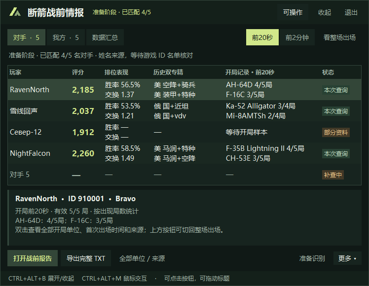

# BA Scout · 断箭战前情报

Windows 上的《Broken Arrow / 断箭》准备阶段情报悬浮窗。程序监听游戏日志，在准备界面读取逐步出现的玩家姓名，查询 BATrace 公开资料，并整理历史对局前 **20 秒 / 120 秒**的单位出场记录。

[下载 Windows 便携版](https://github.com/ziyi612/ba-scout/releases/latest) · [中文使用说明](docs/USER_GUIDE.zh-CN.txt) · [验证范围](docs/VALIDATION.md) · [MIT 许可证](LICENSE)



## 能做什么

- 准备阶段默认显示五个对手位置。某一行连续两帧读到稳定名字便独立查名，确认一人就在该位置显示一人，评分、胜率、历史专精和开局样本陆续填入。
- 在同一准备房间，稳定姓名首轮超时后，程序会在请求额度内自动补查一次。已查完的拼写可复用，网站限流时等待冷却，同名多账号保持待确认。
- 显示可取得的评分、排名、排位统计与历史双专精经验；缺失字段明确显示未取得。
- 同时汇总最近最多五场有效历史对局的前 20 秒与前 120 秒出兵，显示型号、出现局数、次数及来源。
- 网站只返回基础资料时，继续利用已有近期比赛编号查询开局记录；累计战绩暂缺不会伪装成查询成功。
- 自动生成完整 TXT 报告；显示完整单位名称、有效样本分母、缓存时间和缺失原因。
- 中、英、俄三种 Windows OCR 引擎协同读取姓名；同名多账号、截断姓名等情况保持待确认。

这是**数据汇总工具**，不推荐卡组，也不把历史频率解释为下一局概率。程序读取普通日志和已核验游戏窗口的画面，不注入游戏、不读取游戏内存、不操作匹配或选卡。

## 开源版范围

本仓库及公开安装包**不包含从游戏数据库提取的单位资料**。因此，不提供依赖该资料的坦克、防空等细分角色分类；公开对局中实际返回的单位名称、出场数量、时间窗口与基础类别仍可显示。界面会明确提示分类库缺失。

游戏素材、商标和 BATrace 网站内容不因本项目而获得 MIT 授权。源码授权及运行库说明见 [第三方声明](THIRD_PARTY_NOTICES.md)。本工具并非游戏开发商、发行商或 BATrace 的官方产品。

## 普通用户使用

1. 从 [Releases](https://github.com/ziyi612/ba-scout/releases) 下载 Windows x64 ZIP，**完整解压**到自己有写入权限的文件夹。
2. 保留 `_internal`、`data`、`licenses` 等目录，双击 `BA-Scout.exe`。
3. 首次填写自己的 **BATrace 数字玩家 ID** 与游戏 `GameLogs` 目录；软件不会代替你从同名账号中猜选身份。
4. 保持程序运行，正常进入游戏准备阶段。支持的姓名布局下会自动开始查询；不同 UI 比例、分辨率或布局可能需要在“准备识别”中校准姓名框。
5. 顶栏下方可切换对手、我方、数据汇总及开局时间窗。单击评分或状态可选中一行，双击已确认的玩家可查看详情。刷新、回放、复制和设置位于右下角“更多”。

| 操作 | 快捷键 |
| --- | --- |
| 展开 / 收起 | `Ctrl+Alt+B` |
| 鼠标穿透 / 允许操作 | `Ctrl+Alt+M` |

运行条件为 **Windows 10/11 x64**、可用的 Windows PowerShell 5.1 和 Windows OCR。英文、简体中文、俄文 OCR 的可用情况取决于系统安装的语言组件。推荐窗口或无边框模式；独占全屏中的悬浮窗可见性需要在实际游戏里确认。

“20 秒查询目标”不是保证每次 20 秒内查齐五个人。网络、网站字段缺失、同名账号和后出现的名字都会影响结果；首次预算结束后，准备阶段后出现的名字仍可获得有限补查窗口。匹配人数、完整战绩人数和有效历史样本数应分别阅读。

## 从源码运行

使用 **Windows x64、CPython 3.13**（发行构建采用 3.13.2，需带 Tkinter）。运行本体使用 Python 标准库，不需要安装 pip 运行时依赖。WinRT OCR 通过系统 PowerShell 工作进程调用。

在源码目录运行：

```powershell
python -B app.py
```

程序将配置、缓存、截图、日志、报告和临时文件保存在**程序所在目录**。请勿直接在无写入权限的目录运行。本地开发建议使用可写的独立目录，例如 `F:\Projects\ba-scout`。

## 测试与构建

运行不需要真实游戏日志或联网的测试：

```powershell
python -B tests/run_tests.py
```

可选 OCR 检查使用自己有权使用的准备画面，通过 `BA_SCOUT_TEST_OCR_IMAGE` / `BA_SCOUT_TEST_OCR_REGIONS_IMAGE` 环境变量提供绝对路径。不提供图片时，相应实图检查会跳过；这不表示完成了实战验证。

在 Windows 上运行 `python -B tests/prep_acceptance.py` 可复现五个名字陆续出现、其中一人首次查名超时后恢复的场景。测试使用合成画面、Windows OCR、本机 HTTP 服务和正常悬浮窗，把各行实际上屏的时间保存在 `work/acceptance/`。

构建 Windows 便携版：

```powershell
python -m venv .venv
.\.venv\Scripts\python.exe -m pip install --cache-dir .build-cache\pip -r requirements-build.txt
.\.venv\Scripts\python.exe -B tools/build_windows.py
```

构建脚本把 PyInstaller 的临时文件与缓存放在项目目录，输出到 `dist/`，并生成 ZIP 与 SHA-256 校验文件。公开打包采用文件白名单，不收录个人配置、游戏日志、截图、查询缓存、报告或游戏数据库。

## 数据和隐私

程序访问 `https://dash.batrace.top` 的公开玩家搜索、玩家页和对局页，会将查询的姓名或数字 ID 发送给该网站。它受网站可用性与限流影响，没有登录绕过或无限重试。

本机 `config.json` 保存你填写的玩家 ID 与日志路径；缓存和报告可能包含其他玩家的公开资料。`.gitignore` 已排除这些运行数据。提交问题时请先去掉个人路径、账号、截图中的聊天内容，以及不需要公开的玩家信息。

## 开发与许可

项目源码和原创说明使用 [MIT License](LICENSE)。Python、Tcl/Tk、PyInstaller 等组件保留各自许可，详见 [THIRD_PARTY_NOTICES.md](THIRD_PARTY_NOTICES.md) 与 `licenses/`。

修改请保持：不猜测身份、不把缺失值当零、不将旧缓存标成新数据、不把受控录制测试称为真实联网或实局验收。
